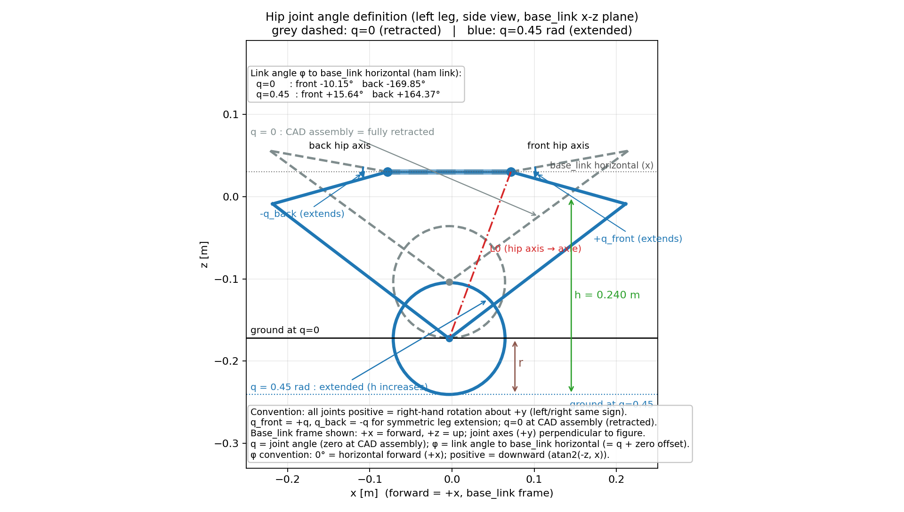
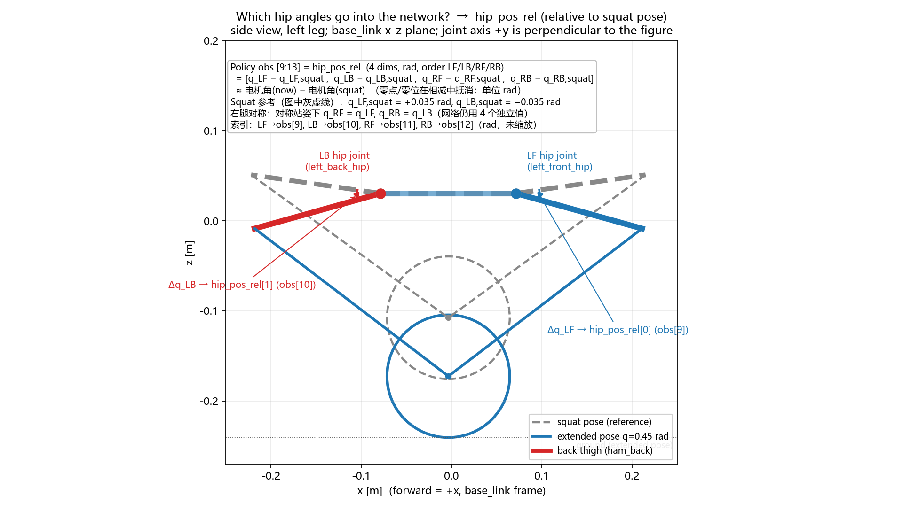
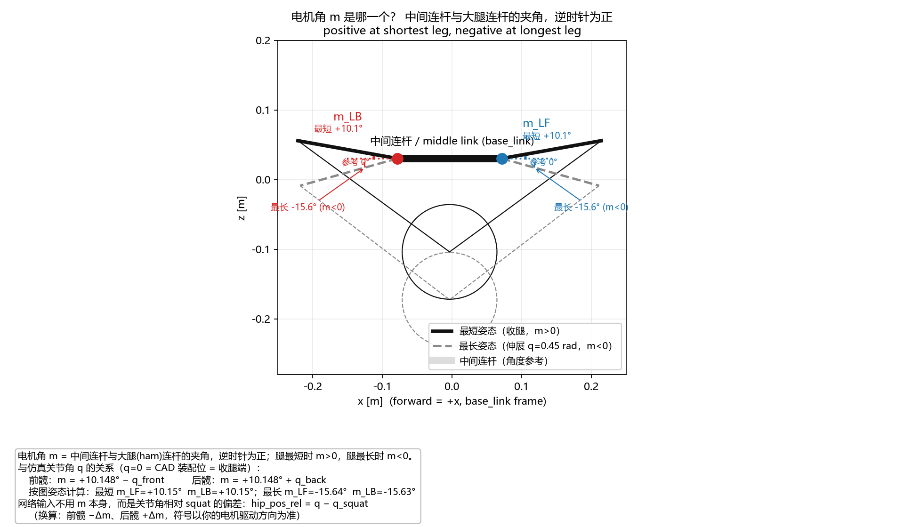

# chassis_rl_lab 使用手册（训练 / 续训 / 回放 / 数据 / 部署）

> 所有命令都在**项目根**执行。8 GB 显存建议 `--num_envs 256`（更稳；1024 有 GPU TDR 崩溃风险）。
>
> ```powershell
> cd D:\Robomaster\RL\chassis_rl_lab
> ```
>
> 观测 **25 维** / 动作 **6 维**（4 髋力矩 + 2 轮力矩），所有任务维度一致，可互相 `--resume`。

## 1. 任务一览

| 任务 id | 用途 | 起点 | 髋关节 | 高度指令 |
|---|---|---|---|---|
| `Chassis-Stand-Up-Squat-Fixed-v0` | **课程①**：固定方向倒地→起立→蹲姿平衡 | 收腿倒地（pitch +14~19° 固定） | 全开放（6 维力矩） | 固定最低 0.1717 m |
| `Chassis-Stand-Up-Squat-v0` | **课程②**：随机方向倒地→起立→蹲姿平衡 | 收腿倒地（方向随机） | 全开放 | 固定最低 0.1717 m |
| `Chassis-Stand-Up-Height-v0` | **课程③**：变腿长（高度跟踪 0.172~0.270 m） | 收腿倒地（方向随机） | 全开放 | 每 episode 随机 |
| `Chassis-Stand-Up-Recovery-v0` | 旧版：倒地自起+平衡（不跟踪高度） | 收腿倒地（随机） | 全开放 | 固定名义 0.1716 m |
| `Chassis-Stand-Up-v0` | 旧版：屏蔽髋、纯轮平衡（阶段1预训练） | 倒地（squat 腿型） | **屏蔽**（腿不动） | 固定名义 0.1716 m |

**推荐训练顺序（课程 A）**：`Squat-Fixed` → `Squat` → `Height`，每段 `--resume` 上一段。

## 2. 最常用命令

### 2.1 课程① 固定方向倒地（最低腿长 + 髋全开放）

```powershell
# 从已有模型继续（推荐）：--resume --load_checkpoint <模型路径>
D:\miniconda\envs\RM\python.exe scripts\train.py --headless ^
  --task Chassis-Stand-Up-Squat-Fixed-v0 ^
  --resume --load_checkpoint "logs\rsl_rl\chassis_rl_stand_up\2026-11-07_20-46-35_squat_hips_cont\model_6698.pt" ^
  --num_envs 256 --max_iterations 500 --export_interval 100 --run_name c1_fixed

# 从头训练：去掉 --resume 那一行
```

### 2.2 课程② 随机方向倒地

```powershell
D:\miniconda\envs\RM\python.exe scripts\train.py --headless ^
  --task Chassis-Stand-Up-Squat-v0 ^
  --resume --load_run ".*c1_fixed" --load_checkpoint -1 ^
  --num_envs 256 --max_iterations 500 --export_interval 100 --run_name c2_random
```

### 2.3 课程③ 变腿长（0.172~0.270 m）

```powershell
D:\miniconda\envs\RM\python.exe scripts\train.py --headless ^
  --task Chassis-Stand-Up-Height-v0 ^
  --resume --load_run ".*c2_random" --load_checkpoint -1 ^
  --num_envs 256 --max_iterations 1500 --export_interval 100 --run_name c3_height
```

- 高度指令带 curriculum（1500 iter 内从名义高度慢慢放开到 0.270）；
- 奖励：`exp(-(h-h_cmd)²/0.0025)×3.0` + 误差平方惩罚 `-(h-h_cmd)²×40` + 高度变化率惩罚；
- 成功判据：`Episode_Reward/base_height_track` 上升、`Height/now` 跟随 0.172~0.270、`State/hip_split` < 0.05 rad。

### 2.4 既有模型的当前水平（参考）

| run / checkpoint | 行为 |
|---|---|
| `2026-11-07_20-46-35_squat_hips_cont\model_6698` | 蹲姿（最低腿长）起立+平衡：ep_len 1000、failed_to_recover 0、高度误差 +0.6 mm、劈叉 0.009 rad |
| `2026-11-07_18-35-00_stage2_sym027_v2\model_5899` | 变腿长：0.172~0.270 m 跟踪误差 ≤ 数 mm、劈叉 0.014 rad |

## 3. 回放 / 查看效果

### 3.1 回放（GUI 窗口）

```powershell
# 蹲姿模型（课程①②）：去掉 --headless 就会打开 Isaac Sim 视口
D:\miniconda\envs\RM\python.exe scripts\play.py --task Chassis-Stand-Up-Squat-v0 ^
  --load_run ".*c2_random" --checkpoint -1 --num_envs 1 --episodes 2 --no-assist --trace

# 变腿长模型（课程③）：--height_sweep 每 N 步在最低/最高高度间切换，肉眼可见起伏
D:\miniconda\envs\RM\python.exe scripts\play.py --task Chassis-Stand-Up-Height-v0 ^
  --load_run ".*c3_height" --checkpoint -1 --num_envs 1 --episodes 2 --no-assist ^
  --height_sweep --sweep_interval 100 --trace
```

- `--trace`：打印 `pitch/roll/base_z`；Height 任务额外打印 `h_cmd`（指令高度）/`h_err`；
- `--height_sweep` 的范围取任务 cfg（Height 任务为 0.172↔0.270）；
- 回放默认带观测噪声、带辅助（辅助退火从 1.0 重来）；判断真实水平请加 `--no-assist`，要看理想观测加 `--no-noise`。

### 3.2 查看指定 run / 指定 .pt

```powershell
# 列出所有 checkpoint（按时间）
Get-ChildItem logs\rsl_rl\chassis_rl_stand_up -Recurse -Filter "model_*.pt" |
  Sort-Object LastWriteTime | Select-Object FullName, LastWriteTime

# 回放指定 .pt（完整路径最稳）
D:\miniconda\envs\RM\python.exe scripts\play.py --task Chassis-Stand-Up-Squat-v0 ^
  --checkpoint "logs\rsl_rl\chassis_rl_stand_up\<run>\model_XXXX.pt" --num_envs 1 --episodes 2 --no-assist

# 看 .pt 内容（迭代数/键名）
D:\miniconda\envs\RM\python.exe -c "import torch; d=torch.load(r'logs\rsl_rl\chassis_rl_stand_up\<run>\model_XXXX.pt', map_location='cpu', weights_only=False); print(list(d.keys())); print('iter =', d.get('iter'))"
```

### 3.3 量化检查（无窗口）

```powershell
# 高度跟踪：给 0.172 / 0.221 / 0.270 三档指令，打印实测高度/误差/劈叉（仅适合 Height 模型）
D:\miniconda\envs\RM\python.exe tools\check_height_tracking.py ^
  --checkpoint "logs\rsl_rl\chassis_rl_stand_up\<run>\model_XXXX.pt" --num_envs 3

# 环境自检（动作/观测维度、奖励有限性、基础高度）
D:\miniconda\envs\RM\python.exe tools\check_env.py --task Chassis-Stand-Up-Squat-v0 --num_envs 8 --steps 120
```

### 3.4 TensorBoard

```powershell
D:\miniconda\envs\RM\python.exe -m tensorboard.main --logdir logs\rsl_rl\chassis_rl_stand_up --port 6006
```

重点指标：`Height/target`、`Height/now`、`Height/error`、`State/hip_split`、`Episode_Reward/base_height_track`、
`Train/mean_episode_length`、`Episode_Termination/failed_to_recover`。

## 4. 训练数据（`data/`，按时间戳快照，不覆盖）

每 `--export_interval` 轮（默认 100）导出一次"从训练开始到当前"的累计数据，
**每次在 run 文件夹内新建一个时间戳快照**（历史全部保留）；训练结束 / Ctrl+C 再存最终快照：

```
data\<时间戳>_<run名>\
    snapshot_<YYYYmmdd_HHMMSS>\
        metrics.csv          全部指标（iteration,tag,value 长格式；含 Height/State/Joint/*）
        height_tracking.csv  高度跟踪宽表（height_target / height_now / height_error）
        summary.json         各指标 first/last/min/max + checkpoint 列表 + 训练配置
        README.md
        env.yaml / agent.yaml
        plots\
            00_height_tracking.png   目标 vs 当前高度 / 误差
            01_train.png             平均奖励 / episode 长度
            02_episode_reward.png    奖励分项
            03_termination.png       终止项比例
            04_losses.png            损失
            05_policy_lr.png         lr / action std
            06_perf.png              FPS / 耗时
            07_base_state.png        机体高度 / pitch-roll / 速度 / 劈叉
            08_joint_positions.png   各关节位置（4 hip + 4 knee + 2 wheel）
            09_joint_velocities.png  各关节速度
            10_joint_torques.png     各关节力矩
```

打开最新快照：

```powershell
$run  = Get-ChildItem data -Directory | Sort-Object Name | Select-Object -Last 1
$snap = Get-ChildItem $run.FullName -Directory | Sort-Object Name | Select-Object -Last 1
start "" "$($snap.FullName)\plots"
start "" "$($snap.FullName)\height_tracking.csv"
```

补导出已有 run：`... tools\export_training_data.py --log_dir <run 目录> [--data_root D:\rl_data]`

## 5. 指令替换对照表

### 5.1 训练 / 续训

| 我想… | 参数 |
|---|---|
| 换课程阶段 | `--task Chassis-Stand-Up-Squat-Fixed-v0 / Chassis-Stand-Up-Squat-v0 / Chassis-Stand-Up-Height-v0` |
| 并行环境数 | `--num_envs 256`（默认；1024 易触发驱动 TDR） |
| 训练长度 | `--max_iterations 500`（这是**追加**轮数；续训从 checkpoint 的 iter 接着算） |
| 区分实验 | `--run_name c1_fixed` |
| 续训最新 | `--resume`（自动找该实验最新 run 的最新 checkpoint） |
| 续训指定 run 的最新 | `--resume --load_run ".*c2_random" --load_checkpoint -1` |
| 续训指定 .pt | `--resume --load_checkpoint "logs\...\model_6698.pt"` |
| 数据保存频率 | `--export_interval 100`（0 = 只在结束时导出） |
| 不导出数据 | `--no_data_export` |
| 改数据根目录 | `--data_root D:\rl_data` |
| 随机种子 | `--seed 17`（默认） |
| 保存间隔 | `--save_interval 50`（默认） |

### 5.2 回放 / 导出

| 我想… | 命令 |
|---|---|
| 回放最新模型 | `... scripts\play.py --load_run ".*<run>" --checkpoint -1 --episodes 2 --no-assist` |
| 回放指定 .pt | `... scripts\play.py --checkpoint "logs\...\model_XXXX.pt" ...` |
| 看变腿高起伏 | 加 `--height_sweep --sweep_interval 100`（仅 Height 任务） |
| 打印逐步数值 | 加 `--trace` |
| GUI 窗口 | 去掉 `--headless`，`--num_envs 1` |
| 导出 ONNX（最新） | `... scripts\export_onnx.py --checkpoint -1`（输出 `exports\chassis_standup_policy.onnx`，25 维输入） |
| 导出指定 .pt | `... scripts\export_onnx.py --task Chassis-Stand-Up-Height-v0 --checkpoint "logs\...\model_XXXX.pt"` |
| 校验 ONNX | 独立进程：`... -c "import onnx;m=onnx.load(r'exports\chassis_standup_policy.onnx');onnx.checker.check_model(m);print('OK')"` |
| 环境自检 | `... tools\check_env.py --task <任务 id> --num_envs 8 --steps 120` |
| 展示用 USD | `... tools\make_display_usd.py --verify` |

## 6. 鲁棒性（当前训练默认开启）

| 类别 | 内容 | 位置 |
|---|---|---|
| 观测噪声 | BMI088 陀螺/加速度计噪声 | `sensor_noise.py` + ObsTerm |
| IMU 零偏/安装误差 | 陀螺零偏 ±0.01 rad/s、倾角偏置 ±1°（每 episode） | `EventCfg.reset_sensor_bias` |
| 动作延迟 | 每 env 随机 0~2 控制步（≈0~40 ms） | `ActionsCfg*.wheel_leg.action_delay_max` |
| 力矩误差/滞后 | 缩放 ±10%、一阶低通 20~50 ms | `torque_scale_range / torque_lpf_tau_range` |
| 物理参数 DR | 轮-地摩擦 0.3~1.2、机身质量 ±0.5 kg、质心 ±1 cm、关节摩擦 0~0.05、执行器增益 0.8~1.2 | `EventCfg.randomize_*`（startup） |
| 随机推力 | 每 1.5~3 s，±0.25 m/s / yaw ±0.3；强冲击每 6~10 s，±0.45 m/s | `EventCfg.push_robot / push_robot_strong` |
| 起始随机 | 倒地方向/姿态/速度、髋初始角、高度指令 | `EventCfg.reset_*` |
| 行为约束 | 左右对称（hip_symmetry −2.0 / wheel_symmetry −0.02）、倒地方向课程 | `RewardsCfg` |
| 安全 | 动作限幅、NaN 防护、异常状态终止 | `actions.py / wrappers.py / terminations.py` |

关闭个别项：把对应 `EventTerm` 设为 `None`（如 `EventCfg.push_robot_strong = None`）或把参数调温和。

## 7. 真机部署要点

### 7.1 高度 / 腿长 / 髋角 换算

完整公式、对照表与电机角换算见独立文档 **[interface.md](interface.md)**（§3）。

速记：

- `h = L0 + 0.0376 m`（L0 = 轮轴到髋电机轴的竖直距离；`0.0376 = r − z_hip`）；
- 相对 squat：`Δh = ΔL0`（常数抵消）；
- squat 参考：`h = 0.17561 m`、`L0 = 138.0 mm`；
- 精确计算：`FiveBarSolver.base_height(q)`（见 interface.md §3.4）。

### 7.2 关节角坐标：仿真 vs 电机返回角

仿真/URDF 用 **CAD 零位关节角**（q=0 = 机械收回端）；你最初填写的 `底盘数据.txt` 是**电机返回角**，
两者只差常数零位偏置（范围宽度一致）：

| 关节 | 仿真关节角范围 | 电机返回角范围 | 换算 |
|---|---|---|---|
| 前髋 | 0 ~ +85.31° | −10.15° ~ +75.16° | motor = sim − 10.148° |
| 后髋 | −85.35° ~ 0 | +104.80° ~ +190.15° | motor = sim + 190.148° |
| 前膝 | −114.54° ~ 0 | — | motor = sim + 143.75° |
| 后膝 | 0 ~ +114.56° | — | motor = sim + 36.25° |

- 代码：`chassis_rl_lab/kinematics/conventions.py`（`sim_to_motor_deg / motor_deg_to_sim / print_conversion_table`）；
- 策略观测 `hip_pos_rel = 关节角 − squat 关节角`，**零位偏置会抵消**（若你的读数是 §7.1 的 m 约定，先换算成 q 再减 squat q）：
  `hip_pos_rel = motor_deg − motor_squat_deg`，其中 `motor_squat = [−8.144°, +188.144°, −8.144°, +188.144°]`（顺序 LF/LB/RF/RB）；
- 力矩动作正方向 = 电机角增大方向，符号不翻转。

### 7.3 ONNX 部署接口

- 输入：25 维观测（ang_vel×0.25 → gravity → commands(3) → hip_pos_rel(4) → dof_vel(6)×0.05 → last_action(6)）；
- 输出：6 维动作 → 髋力矩 `×2.5` 夹 ±20 Nm（连续上限）、轮力矩 `×1` 夹 ±4.92 Nm；
- 完整的 **25 维观测顺序** 与 **6 维动作映射** 见 [interface.md](interface.md) §1/§2；
- 高度指令必须由外部给（`commands[2] = height_cmd × 5`），否则策略只会保持默认高度。

### 7.4 髋关节角定义（图例）



（图由 `tools/plot_hip_angle_definition.py` 生成，`docs/figures/hip_angle_definition.png`）

**网络输入里的 4 个髋角**（obs[9:13] = `hip_pos_rel`，rad，顺序 LF/LB/RF/RB）：



（图由 `tools/plot_obs_hip_angles.py` 生成，`docs/figures/obs_hip_angles.png`）

- `hip_pos_rel[i] = 当前髋角 − squat 姿态髋角`（不是绝对角，也不是相对水平的 φ）；
- 图里蓝点 = 左前髋（LF）、红点 = 左后髋（LB）；灰虚线 = squat 参考姿态，蓝线 = 伸展姿态；
  Δq 即两条大腿连杆方向之间的夹角（= 该髋关节角变化量）；
- 索引：`LF→obs[9]`、`LB→obs[10]`、`RF→obs[11]`、`RB→obs[12]`，单位 rad、不缩放；
- squat 姿态时 4 个值都 ≈ 0；右腿对称站姿下 RF=LF、RB=LB（但网络仍用 4 个独立值）；
- 真机可用 `Δ = 电机角(now) − 电机角(squat)` 计算（零位抵消；符号按你的电机方向约定标定）。

- **两种"角"要区分**：
  - **关节角 q（本仓库/URDF 用）**：相对**零位（CAD 装配位）**的关节坐标，q=0 时连杆并不水平；
  - **连杆相对机体水平的绝对角 φ（你 LQR/电机范围用）**：φ = q + 零位偏置 ——
    前髋 φ = q − 10.148°、后髋 φ = q + 190.148°（mod 360）、前膝 φ = q + 143.75°、后膝 φ = q + 36.25°；
  - 例：前髋 q=0 → φ = −10.15°（水平前方**向上**约 10°）；q=0.45 → φ = +15.64°；
    后髋 q=0 → φ = 190.15°（≡ −169.85°），q_back=−0.45 → φ = 164.37°；
  - φ 符号约定：**0° = 水平向前 (+x)，向下为正**（`atan2(-z, x)`）；
  - 换算函数：`sim_to_link_deg / link_deg_to_sim`（`chassis_rl_lab/kinematics/conventions.py`）。
- **正方向**：所有关节绕世界 **+y 轴右手定则**旋转为正（从 +y 看向 −y 逆时针），左右同号；
- **零点 q=0**：CAD 装配位 = **机械收回端**（腿最短，L0≈0.104 m，h≈0.1717 m）；
- **对称伸展**：`q_front = +q, q_back = −q`（左前/左后、右前/右后同号）；
- **正方向含义**：前髋 +q 使大腿向下摆 → 腿伸长、机体高度 h 增大；后髋 −q 同样使腿伸长；
- **范围**：前髋 `[0°, +85.31°]`、后髋 `[−85.35°, 0]`；squat 姿态 q≈+0.035 rad(2°)；
  训练高度 0.172~0.270 m 对应 q≈0~0.60 rad（0~34.4°）；
- **几何关系**：L0 = 轮轴到髋电机轴的平面距离，`h = L0 + r`（r = 0.068 m；误差 <0.1 mm）；
- **电机返回角**：`motor = sim + offset`（前髋 −10.148°、后髋 +190.148°、前膝 +143.75°、后膝 +36.25°），
  详见 §7.2 与 `chassis_rl_lab/kinematics/conventions.py`。

### 7.5 电机角（电机返回的那个角）在图里是哪个



（图由 `tools/plot_motor_angle_definition.py` 生成）

- **电机角 m** = 中间连杆（两个髋轴之间的机架）与**大腿（ham）连杆**的夹角，逆时针为正；
- 腿**最短**（收腿）时 `m > 0`（约 **+10.15°**）；腿**最长**时 `m < 0`（约 **−15.6°**），
  与你描述的电机读数一致；
- 与仿真关节角 q 的关系（q=0 = CAD 装配位 = 收腿端）：
  `前髋 m = +10.148° − q_front`，`后髋 m = +10.148° + q_back`；
- **网络输入不是 m 本身**，而是关节角相对 squat 的偏差：
  `hip_pos_rel = q − q_squat`；用电机角算就是 `Δm = m(now) − m(squat)`，
  再按关节方向取符号（前髋 −Δm、后髋 +Δm，最终以你的电机驱动方向标定）；
- 真机建议：站成 squat 时记录 4 个电机读数作为 `m_squat`，之后每帧算 Δm 再代入。

## 8. 稳定性：TDR 与 NaN 防护

### 8.1 Windows TDR（显卡超时）

训练偶发崩溃、事件日志出现 `nvlddmkm` + `LiveKernelEvent/LKD_0x141_Tdr` 时是 TDR。
**管理员** PowerShell（重启生效）：

```powershell
$k = 'HKLM:\SYSTEM\CurrentControlSet\Control\GraphicsDrivers'
New-ItemProperty -Path $k -Name TdrDelay    -Value 60 -PropertyType DWord -Force
New-ItemProperty -Path $k -Name TdrDdiDelay -Value 60 -PropertyType DWord -Force
# 可选：关闭硬件加速 GPU 计划
New-ItemProperty -Path $k -Name HwSchMode   -Value 1  -PropertyType DWord -Force
Restart-Computer
```

还原：删除 `TdrDelay/TdrDdiDelay` 并把 `HwSchMode` 设回 2。建议同时用 `--num_envs 256`。

### 8.2 NaN 防护

1. **环境终止**：`TerminationsCfg.state_invalid` —— 根/关节状态 NaN/Inf 或速度超限（线 30 m/s / 角 60 rad/s / 关节 200 rad/s）立即终止该 env；
2. **obs/reward 过滤**：`chassis_rl_lab/utils/wrappers.py::SanitizeWrapper`（train.py/play.py 自动挂载，NaN→0 并限幅）；
3. **动作层**：动作项对策略动作、实测髋角、闭链 knee 目标做 `nan_to_num`。

## 9. 常见坑

1. **没 cd 到项目根** → 找不到 `scripts\train.py`，日志也会写错位置。
2. `--task` 必须是注册 id（见第 1 节），不是 run 名。
3. **`--load_run` 是正则**：每次启动训练都会新建 run 目录，同一正则可能匹配多个 run（取排序最后）。续训请写精确的 run 名，或直接 `--load_checkpoint <完整路径>`。
4. **`--max_iterations` 是追加轮数**（rsl_rl 语义），不是总轮数；续训从 checkpoint 的 iter 接着算。
5. 回放默认**带辅助/带噪声**；判断真实水平加 `--no-assist`。
6. 旧 checkpoint（2 维动作 / 旧 25 维布局）不能用于新任务；现有 5 个任务维度一致，可互相 resume。
7. **数据快照路径**：新训练在 `data/<run>/snapshot_<时间戳>/` 下，不再直接放 `data/<run>/`。
8. 导出的 ONNX **不要在 Isaac Sim 进程内**做 `onnx.checker`（Windows 会崩），用独立进程校验。
9. GPU TDR 崩溃后用该 run 最新 checkpoint `--resume` 继续（进度/课程会自动对齐）。
